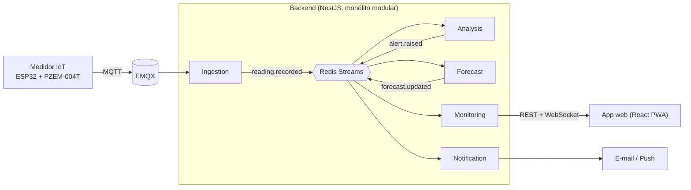

# Monitor de Consumo de Energia Residencial (IoT + eventos)

Protótipo da avaliação de Arquitetura de Software (Uni-FACEF, 2º bimestre de 2026), sistema 17.
Um medidor IoT publica leituras por MQTT; um backend NestJS organizado em módulos independentes processa as leituras por meio de eventos; um app web mostra o consumo em tempo real, os alertas e a previsão da conta do mês.

## Arquitetura



- Os módulos **não se chamam**: só publicam e consomem eventos.
- Cada módulo é **dono do próprio schema** no banco (TimescaleDB).
- Os módulos só compartilham `contracts` (formato dos eventos) e `platform/ports.ts` (interfaces). As implementações concretas (Redis, PostgreSQL) ficam em `platform/adapters` e são ligadas no `PlatformModule`.
- Essas regras são verificadas pelos testes de arquitetura (`backend/test/architecture.test.ts`).

## Estrutura

```
backend/            API e módulos (NestJS)
  src/contracts/    eventos compartilhados (reading.recorded, alert.raised, forecast.updated)
  src/platform/     ports.ts (interfaces) e adapters/ (Redis, Postgres, PlatformModule)
  src/modules/      ingestion, analysis, forecast, notification, monitoring
  src/app.module.ts raiz de composição (escolhe os módulos pela variável MODULES)
  test/             testes unitários, fluxo completo e testes de arquitetura
  scripts/          cálculo das métricas de acoplamento (Ca, Ce, I, A, D)
simulator/          simula vários medidores ESP32 publicando no MQTT
firmware/           sketch do ESP32 + diagrama para o Wokwi
web/                app React (PWA)
infra/              schema do banco (um schema por módulo)
docs/               textos do documento arquitetural
```

## Como rodar

Pré-requisito: Docker Desktop.

```bash
docker compose up --build
```

| O quê | Onde |
|---|---|
| App web | http://localhost:8080 |
| API | http://localhost:3000/api/health |
| Painel do EMQX (broker MQTT) | http://localhost:18083 (admin / public) |
| Caixa de e-mail falsa (Mailpit) | http://localhost:8025 |

O simulador já sobe junto, publicando leituras de duas casas a cada 2 s. De tempos em tempos ele liga o chuveiro (5.500 W, o que dispara um alerta de potência) e simula uma queda de tensão (o que dispara um alerta de tensão). Os alertas aparecem no app e chegam por e-mail no Mailpit.

### Desenvolvimento local (sem Docker para o backend)

```bash
docker compose up -d emqx redis timescaledb mailpit
cd backend && npm install && npm run dev
cd web && npm install && npm run dev        # http://localhost:5173
cd simulator && npm install && npm start
```

### Rodando módulos em processos separados

Por padrão, um processo roda os cinco módulos. Como eles só conversam por eventos, dá para separá-los sem mudar o código:

```bash
MODULES=ingestion npm start
MODULES=analysis,notification npm start
```

## Usando o ESP32 no Wokwi

1. Crie um projeto ESP32 em https://wokwi.com e cole o conteúdo de `firmware/sketch.ino`, `firmware/diagram.json` e `firmware/libraries.txt`.
2. Na simulação: o potenciômetro controla a carga da casa (80–3.000 W), a chave liga o chuveiro (+5.500 W) e o botão vermelho simula uma queda de tensão.
3. O ESP32 do Wokwi publica no broker público `broker.emqx.io`. Para o backend ler de lá:

```bash
BACKEND_MQTT_URL=mqtt://broker.emqx.io:1883 BACKEND_MQTT_CLIENT_ID=backend-ingestion-<algo-unico> docker compose up --build
```

O medidor aparece no app como `home-wokwi / meter-wokwi`. Para o hardware real, só a função `readMeter()` muda (passa a ler o PZEM-004T pela biblioteca `PZEM004Tv30`); o formato publicado continua o mesmo.

## Testes e métricas

```bash
cd backend
npm test           # unitários, fluxo completo (Nest + infraestrutura em memória) e regras de arquitetura
npm run metrics    # Ca, Ce, instabilidade, abstração e distância da sequência principal
```

## Documento ↔ código

| Seção do documento | Onde ver no código |
|---|---|
| 3. Identificação dos módulos | `backend/src/modules/*` (um `*.module.ts` por módulo) |
| 4. Coesão | cada módulo concentra uma responsabilidade: `ingestion` (entrada), `analysis` (regras), `forecast` (projeção), `notification` (entrega), `monitoring` (consulta e tempo real) |
| 5. Acoplamento | `backend/src/contracts`, `backend/src/platform/ports.ts`, `PlatformModule`, `backend/test/architecture.test.ts`, `npm run metrics` |
| 6. Conascência | nomes dos eventos e tópicos (`contracts/events.ts`), tipos verificados pelo compilador, convenção de unidades traduzida em `ingestion/translator.ts` |
| 7. Justificativas | `docker-compose.yml` (componentes), `app.module.ts` (variável `MODULES`), consumidores idempotentes nos repositórios |
